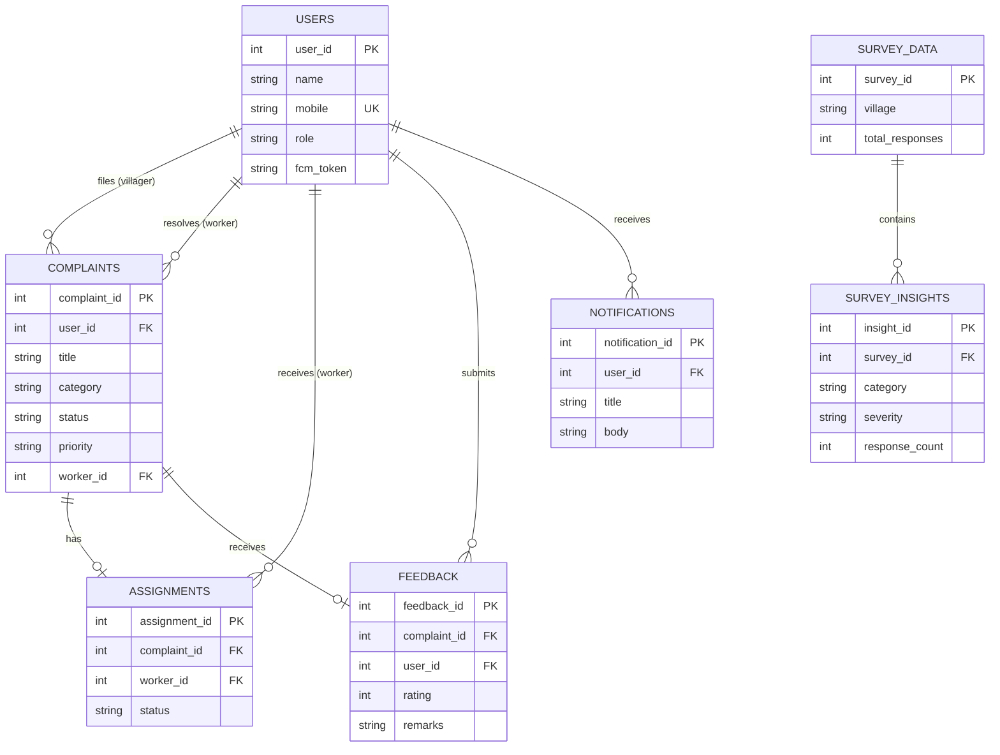

# Entity Relationship Diagram (ERD)

The following Mermaid.js diagram illustrates the relationships and cardinalities between the entities in the Gadepudi Village CSP system.

## Cardinality Notes
- **Users to Complaints:** A villager (User) can submit **Zero or Many** complaints. A worker (User) can be assigned to **Zero or Many** complaints.
- **Complaints to Feedback:** A complaint can have **Zero or One** feedback record attached to it once resolved.
- **Complaints to Assignments:** An assignment acts as a junction/tracking table between Complaints and Workers for auditing purposes.
