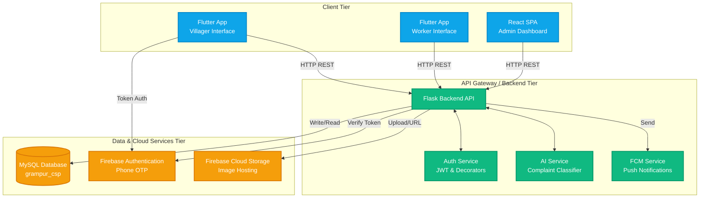

# System Architecture

The Gadepudi Village Complaint Redressal System follows a decoupled, service-oriented architecture.

## Flow Descriptions
1. **Authentication Flow:** Flutter app sends phone number to Firebase Auth. User receives OTP. Flutter sends resulting ID Token to Flask Backend. Flask verifies with Firebase Admin SDK and issues a custom JWT.
2. **Complaint Submission Flow:** Villager submits data via Flutter. Flask receives request, saves image to Firebase Storage, queries AI Classifier if category is missing, and saves record to MySQL.
3. **Notification Flow:** When Admin updates a status or assigns a worker, Flask inserts a record into MySQL `notifications` and triggers Firebase Cloud Messaging (FCM) to push the alert to the target device.
